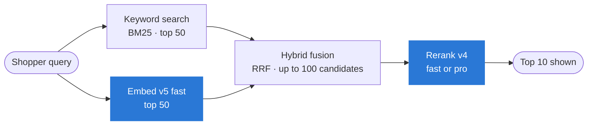
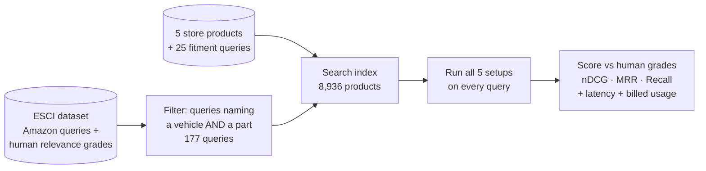
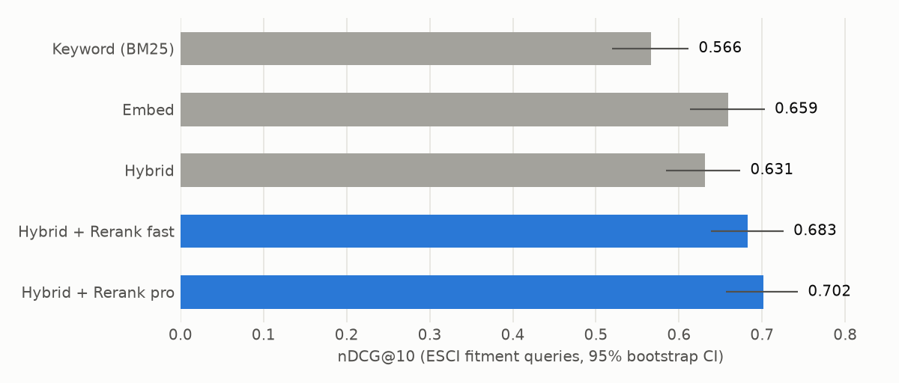
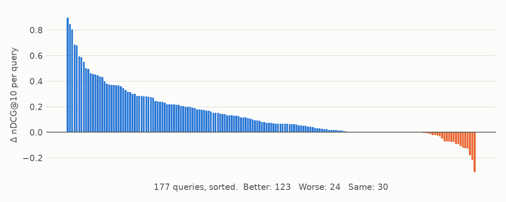
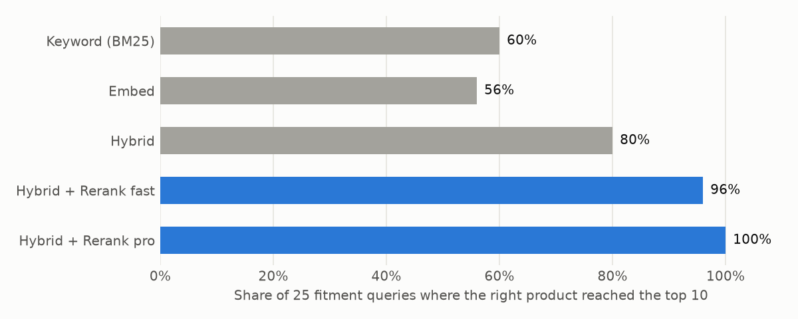
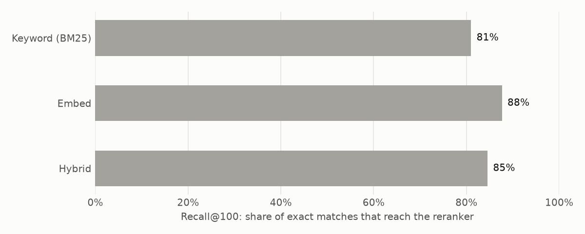
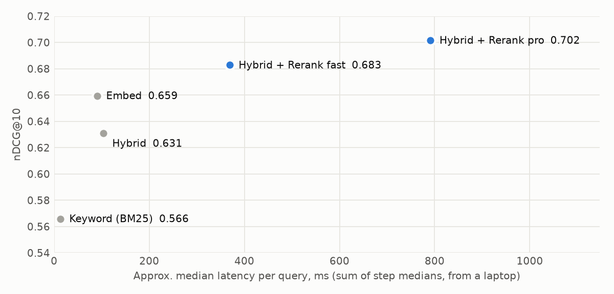
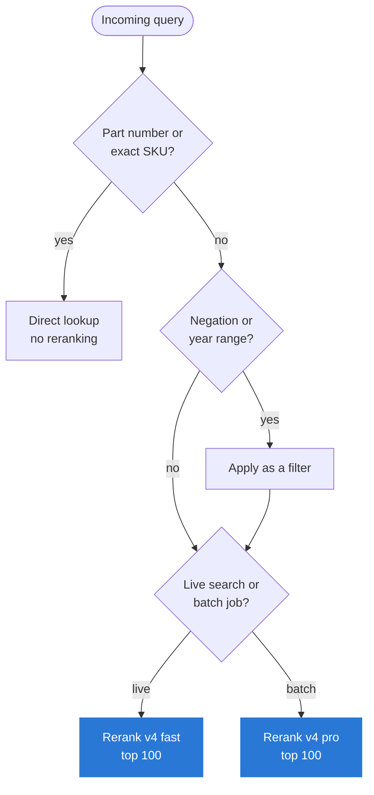

# Rerank for Fitment Search: Before and After

**Adding Cohere Rerank to an existing product search: how much better does it find the right part for the right vehicle, and what does it cost in latency and spend?**

| First-page quality (nDCG@10) | Right product on page one | Added latency (median) |
|:---:|:---:|:---:|
| **0.566 → 0.702**<br/>+24% on 177 real fitment queries | **60% → 100%**<br/>25 queries for 5 store products | **+0.27 s** Rerank fast<br/>**+0.69 s** Rerank pro |

### Same query, before and after

| Shopper query | #1 result with keyword search | #1 result with Rerank pro |
|---|---|---|
| *cx7 mazda antennas* | ❌ Antenna "compatible with BMW, Chevrolet, Dodge, Lexus…" | ✅ AM-FM roof antenna mast for Mazda CX-7 (2007–2012) |
| *01 ford ranger headlights not smoke lens* | ❌ **Smoke** headlights for 2001–2011 Ford Ranger | ✅ Clear headlight assembly for 2001–2011 Ford Ranger |
| *02 gmc denali headlight mounting bracket* | ❌ Headlight support panel for Chevrolet Silverado | ✅ GM headlight lamp support mounting panel |

❌ / ✅ are the human relevance grades from the dataset (Irrelevant / Exact).

## The problem

Auto parts shoppers search the way they talk: *"08 tundra chrome tailgate handle without camera"*, *"nerf bars f350 crew cab"*. One query packs a part type, a vehicle (year, make, model, generation, cab or bed) and sometimes a negation.

- **Keyword search** matches words, not intent. For *"01 ford ranger headlights not smoke lens"*, it ranks smoke headlights first because they match every word.
- **Embedding search** captures intent but blurs fine distinctions: F-250 vs F-350, 2008 vs 2018.
- **A wrong part means a return.** Ranking quality turns directly into revenue and cost.

**Who this is for:** a parts and accessories retailer that runs its own site search (Elasticsearch, OpenSearch, Algolia or similar) and controls how results are ranked.

**The question:** can a reranking step, added to the search they already run, measurably improve results without rebuilding the stack?

## Architecture



Rerank sits **after** retrieval. It takes the candidates any search engine already returns and reorders them in one API call, with no re-indexing and no vector database. Embed is included to show what meaning-based retrieval adds on its own.

| Setup | What it is |
|---|---|
| Keyword (BM25) | The typical starting point |
| Embed | `embed-v5.0-fast` vectors, cosine similarity |
| Hybrid | Reciprocal rank fusion of keyword and Embed results |
| Hybrid + Rerank fast | Hybrid top 100, reordered by `rerank-v4.0-fast` |
| Hybrid + Rerank pro | Hybrid top 100, reordered by `rerank-v4.0-pro` |

## How it was measured



- **Queries:** 177 real shopper queries from Amazon's [Shopping Queries dataset (ESCI)](https://github.com/amazon-science/esci-data) (Apache-2.0) that name both a vehicle and a part. People graded about 16 products per query as **E**xact, **S**ubstitute, **C**omplement or **I**rrelevant.
- **Products searched:** 8,936. That's the 2,931 graded products, 6,000 automotive distractors from other queries, and 5 auto accessories from a separate catalog project, each with 5 fitment queries (e.g. *"tonneau cover for 2022 Toyota Tundra 3rd gen"*).
- **Metrics:**
  - **nDCG@10:** how good the whole first page is (E=1, S=0.1, C=0.01, I=0).
  - **MRR@10:** how high the first exact match lands.
  - **Recall@100:** whether the right product was retrieved at all.
- **Confidence:** 95% intervals from a paired bootstrap over queries (2,000 resamples).
- **Latency:** per query, from a laptop through the public API.

## Results



| Setup | nDCG@10 | MRR@10 | Recall@100 | Δ nDCG vs keyword (95% CI) |
|---|---|---|---|---|
| Keyword (BM25) | 0.566 | 0.753 | 0.810 | — |
| Embed | 0.659 | 0.792 | **0.877** | +0.094 [+0.062, +0.123] |
| Hybrid | 0.631 | 0.785 | 0.846 | +0.065 [+0.046, +0.084] |
| Hybrid + Rerank fast | 0.683 | **0.826** | 0.846 | +0.117 [+0.090, +0.145] |
| Hybrid + Rerank pro | **0.702** | 0.811 | 0.846 | **+0.136 [+0.108, +0.164]** |

### The improvement is broad, not driven by a few queries



Rerank pro beats keyword search on 123 of 177 queries and loses on 24. Against the hybrid list it reorders, it adds +0.071 nDCG [+0.048, +0.092]. Its largest gains are short, vague queries where keyword search ranks the vehicle name above the part: *"cx7 mazda antennas"* (+0.90), *"jeep grills wrangler"* (+0.85), *"gmc sierra bully bumper"* (+0.80).

### Store products: the right product reaches page one



For the 25 fitment queries written for the 5 store products, reranking put the right product in the top 10 every time, compared with 15 of 25 for keyword search. This slice is small, with one known-correct product per query.

### Recall sets the ceiling



A reranker can only reorder what it receives. Embed alone retrieved 88% of exact matches in its top 100. The 50+50 hybrid fed to the reranker retrieved 85%: on 47 queries, fusion pushed out exact matches that Embed had found. Rerank still beat Embed alone (+0.042 nDCG [+0.024, +0.062] for pro). Feeding it Embed's top 100 directly should raise its ceiling further.

### Where it still misses

| Query | What happened |
|---|---|
| *tonneau cover for 2022 Toyota Tundra 3rd gen* | #1 result is a cover for **2014–2021** Tundras, the previous generation. The right product came 2nd. |
| *05 f150 rack and pinion without inner tie rod* | −0.31 nDCG vs keyword search. A full suspension kit *with* inner tie rods moved to #1. |
| *08 f250 mirrors without lights* | −0.12 nDCG vs keyword search. |

Rerank handles negation inconsistently: it got *"not smoke lens"* right, but two of its five worst regressions are "without" queries. Negations and exact year ranges are rules, and they belong in structured filters rather than in relevance ranking.

## Cost and latency



| Step | p50 | p95 | Usage per 1,000 queries |
|---|---|---|---|
| Keyword (BM25, local) | 13 ms | 21 ms | none |
| Embed v5 fast, query | 90 ms | 96 ms | 8,386 tokens |
| Rerank v4 fast, 100 docs | 266 ms | 697 ms | 1,000 search units |
| Rerank v4 pro, 100 docs | 688 ms | 2,100 ms | 1,000 search units |
| Embed v5 fast, index 8,936 products (one-off) | — | — | 1.94M tokens |

Usage comes from the API's own billing counts (`meta.billed_units`):

- **Rerank** bills in **search units**: one query with up to 100 documents. Documents over 500 tokens count as several. Products here are capped at 1,200 characters, so each query costs exactly one unit.
- **Embed** bills per input token. Indexing is a one-off cost; each query adds about 8 tokens.
- **Prices:** Cohere doesn't list per-call prices for Embed v5 or Rerank v4 on its site. Set them in `config.py` to see dollar figures.
- **High volume:** Cohere's **Model Vault** offers a dedicated Rerank 4 instance at a flat hourly rate (listed at $5/hour, medium tier).
- **Latency:** measured from a laptop. In-region production latency will be lower.

## Recommendation



**For a retailer whose site search is keyword-based today: add Rerank v4 fast behind the existing search, reranking the top 100.** It delivers most of the gain (+0.117 of +0.136 nDCG), the best MRR, and a median under 300 ms, with no re-indexing.

- **Pro for batch work.** Category pages, recommendation lists and merchandising jobs can absorb its 2.1 s p95 in exchange for +0.019 nDCG [+0.003, +0.035] over fast.
- **Fix recall first.** 15% of exact matches never reached the reranker. Feed it the candidate source with the best recall, or retrieve deeper. 200 candidates cost two search units per query instead of one.
- **Filters for rules.** Pull negations ("without camera") and year ranges out of the query and apply them as structured filters.
- **Skip reranking where it can't help:** exact SKU lookups and single-result queries.

## Limitations

- Ungraded products count as irrelevant. Some distractors are genuinely relevant (another seller's F-150 floor mat), which understates every setup.
- The query filter is keyword-based, so the set leans towards queries that name a make or model.
- The store-products slice has one known-correct product per query. It measures whether the right product surfaced, not full ranking quality.
- The hybrid used a fixed 50+50 split with standard RRF (k=60), untuned.
- Results come from one run on one machine. Latency varies with network and API load.

## Reproduce

```bash
python3.12 -m venv .venv && source .venv/bin/activate
pip install -r requirements.txt
./fetch_data.sh                      # ESCI, ~1.2 GB
python prepare_data.py               # builds data/corpus.jsonl, queries.jsonl, qrels.json

# API key: read from the environment only, never written to disk by this repo
read -s "COHERE_API_KEY?Cohere key: " && export COHERE_API_KEY

python retrieve.py --smoke           # ~12 API calls: checks key + plumbing
python retrieve.py                   # full run, ~530 API calls (fits a trial key's 1,000/month)
python evaluate.py                   # results/summary.md, metrics.json, ndcg.png
python make_figures.py               # remaining README charts
pytest -q
```

Every API response is cached in `data/cache/calls.sqlite`, so re-runs are free. Trial keys allow 10 Rerank calls a minute, so a first full run takes about 45 minutes. With a production key, set `RERANK_CALLS_PER_MIN = 1000` in `config.py`.

## Files

```
config.py          models, sizes, gains, prices, rate limits
prepare_data.py    ESCI filter -> corpus, queries, graded labels; adds the store-products slice
cohere_client.py   ClientV2 wrapper: env-only key, sqlite cache, pacing, retries, latency
retrieve.py        runs the five setups, saves rankings + latency + billed usage
evaluate.py        nDCG / MRR / recall, bootstrap CIs, summary table, nDCG chart
make_figures.py    per-query, store-products, recall and latency charts
tests/             metric unit tests
```
