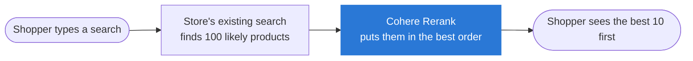

# Better Auto Parts Search with Cohere Rerank

**I added Cohere's Rerank model to a normal product search and measured whether shoppers would find the right car part more often. They did, by a wide margin. The fast version of Rerank adds about a quarter of a second per search.**

| Search quality | Right product on the first page | Extra wait per search |
|:---:|:---:|:---:|
| **21% better** with Rerank fast **24% better** with Rerank pro | **6 in 10 → 10 in 10** with Rerank pro | **0.27 seconds** fast **0.69 seconds** pro |
| on 177 real shopper searches | for 5 test products | typical search |

## Same search, before and after

| What the shopper typed | Top result before | Top result with Rerank |
|---|---|---|
| *cx7 mazda antennas* | ❌ A generic antenna for BMW, Chevrolet, Dodge, Lexus… | ✅ Roof antenna made for the Mazda CX-7 |
| *01 ford ranger headlights not smoke lens* | ❌ **Smoke** headlights (exactly what they didn't want) | ✅ Headlight assembly for the 2001–2011 Ford Ranger |
| *02 gmc denali headlight mounting bracket* | ❌ A bracket for a Chevrolet Silverado | ✅ The GM headlight bracket |

The ❌ and ✅ come from people who reviewed these results by hand, not from me.

## The problem

People shopping for car parts type things like *"nerf bars f350 crew cab"*. That one search mixes a part, a specific vehicle and sometimes a "not" or "without".

Most store search boxes use **keyword search**: they look for products containing the same words. That breaks easily. Search for *"ford ranger headlights not smoke lens"* and keyword search shows smoke headlights first, because they contain every word you typed.

For a parts store, a wrong result is costly: the shopper either leaves or buys the wrong part and returns it.

## What Rerank does

Think of a store's search as two steps:

1. **Find candidates fast.** The search engine grabs the 100 products most likely to match. It's quick but rough.
2. **Put them in the right order.** This is where Rerank comes in. It reads the shopper's search and each of the 100 products *like a person would*, then reorders them so the best matches come first.

**Why it's easy to adopt:** Rerank plugs in after the search a store already has. The store doesn't need to rebuild its search or move its product data. It's one extra step.

I also tested **Cohere Embed**, a different way to find candidates that matches on meaning instead of exact words.

## How I tested it

- **Real searches:** 177 searches that real Amazon shoppers typed, all naming a vehicle and a part. They come from a public dataset Amazon released for research.
- **Graded answers:** human reviewers had already looked at about 16 products per search and marked each one as right or wrong, so there was an answer key to check against.
- **A realistic haystack:** about 9,000 products to search through, including 6,000 car-related products that are wrong for these searches, plus 5 truck accessories from another project of mine with 25 searches written for them.
- **Five setups, same searches:** keyword search on its own, Embed on its own, the two combined, and the combination with Rerank on top (in its fast and pro versions).

## What I found

### 1. Rerank clearly improved search quality

The **search quality score** goes from 0 to 1 and measures how good the first page of results is. It gives more credit when the right products sit near the top. Keyword search scored 0.57; adding Rerank raised it to 0.68 (fast) and 0.70 (pro).

The thin lines show the range each score would likely fall in if I repeated the test with different searches. Rerank's range doesn't overlap keyword search's, so the improvement isn't luck.

### 2. It helped on most searches, not just a few

Each bar is one search. Blue means Rerank made the results better and orange means worse. Compared with keyword search, Rerank pro improved **123 of 177** searches and made **24** worse.

### 3. The right product reached the first page every time

For the 5 test products, keyword search got the right one onto the first page in 15 of 25 searches. With Rerank pro it was 25 of 25 (24 of 25 with fast). That's a small test, but a clear one.

### 4. Rerank can only sort what it's given

If the right product isn't among the 100 candidates, Rerank can't bring it back. Embed on its own found the most correct products (88%). Combining keyword search with Embed actually found fewer (85%). So the next improvement is to give Rerank Embed's results directly.

## Where it still gets it wrong

| What the shopper typed | What went wrong |
|---|---|
| *tonneau cover for 2022 Toyota Tundra 3rd gen* | Top result fits 2014–2021 Tundras, the previous model. The right one came second. |
| *05 f150 rack and pinion without inner tie rod* | Put a kit *with* inner tie rods first. |
| *08 f250 mirrors without lights* | Results got slightly worse than keyword search. |

Rerank is good at meaning but not reliable with strict rules like "without X" or exact model years. A store should treat those as **filters** (like the checkboxes on the side of a search page) rather than leave them to Rerank.

## Speed and cost

| | Typical wait | Slow searches (1 in 20) |
|---|---|---|
| Rerank fast | 0.27 seconds | 0.70 seconds |
| Rerank pro | 0.69 seconds | 2.1 seconds |

- **Higher and to the left is better** on the chart. Rerank fast gets most of the quality for well under half a second.
- **Cost:** Cohere charges Rerank per search (one search covers up to 100 products), so cost grows simply with traffic. Cohere doesn't list the exact price for these models on its website, so the code records usage and works out cost once you add your price.
- **These times were measured from my laptop.** A store's servers would usually be faster.

## What I'd recommend to a parts store

1. **Add Rerank fast** behind the existing search. It gives most of the improvement (21% of the 24%), adds about a quarter of a second to a typical search, and needs no rebuild.
2. **Use Rerank pro for work that isn't live,** like ordering category pages overnight. It's a bit better but slower.
3. **Handle strict rules with filters,** such as "without", exact years and part numbers.
4. **Make sure the first step finds the right products.** Rerank can only reorder what it receives.

## Limits of this test

- The answer key only covers about 16 products per search. Some unreviewed products were probably correct too and counted as wrong, which makes every setup look a little worse than it is.
- The 5 test products are a small sample.
- I ran the test once, from one computer.

## Words used here

| Term | Meaning |
|---|---|
| **Keyword search** | Finds products that contain the same words as the search. Most store search boxes work this way. |
| **Embed** | A Cohere model that turns text into numbers capturing its meaning, so "grille" and "front grill" end up close together. |
| **Rerank** | A Cohere model that reads a search and a list of products, and orders the products from best match to worst. |
| **Fast / pro** | Two versions of Rerank. Fast is quicker; pro is slightly more accurate. |
| **Search quality score** | A 0-to-1 score for how good the first page of results is. Its technical name is nDCG. |
| **Fitment** | Whether a part fits a specific vehicle (year, make, model). |

## More detail

[TECHNICAL.md](TECHNICAL.md) has the full method, every measurement, the exact models, and how to rerun the test yourself.
